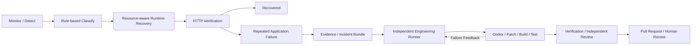

# OpsLoop

**Kubernetes 운영 복구에서 검증된 코드 수정 Pull Request까지 연결하는 Hybrid Failure-Recovery Testbed.**

OpsLoop는 Kubernetes 장애를 근거 기반 규칙으로 분류하고, 자원 상태를 고려한 Runtime Recovery를 시도하도록 설계된 프로젝트입니다. 운영 단계에서 해결되지 않는 반복 Application Failure만 독립된 Engineering Runner로 넘겨 Evidence 수집, 코드 분석·수정, Build/Test Feedback, Verification, Pull Request 생성으로 연결합니다.

> **현재 상태 (2026-10-20): Hybrid 3노드와 Fence v2 ObserveOnly 실환경 검증 완료.** AMD64 Control VM·물리 Worker와 Azure ARM64 Worker에서 Controller·Demo API·내부 Service·Prometheus를 운영합니다. Digest 고정 이미지와 native AMD64/ARM64 Pull·실행, main 보호·수동 승인 Gate·Azure OIDC·ACR 게시가 검증됐습니다. 현재 건강 상태와 과거 완료 이력은 구분합니다.
>
> **IMAGE_PULL / NODE_NOT_READY ObserveOnly 실증 PASS, 시험 리소스 정리 완료.** 이미지 오류는 MANUAL_REQUIRED / CLASS_NOT_AUTOMATED와 Circuit, Azure Worker NodeNotReady는 후보 평가·OBSERVED를 확인했습니다. 두 실험의 attempts는 0이고 Azure Worker 복원은 운영자가 수행했습니다. **Enforce 자동 복구는 실환경 미검증·BLOCKED**, Engineering Runner·자동 수정·PR 파이프라인은 미구현입니다. Node–Deployment 객체 간 원자성 및 partition 중 단일 실행을 보장하지 않습니다.
>
> **전시 Dashboard:** [Demo / Live / Evidence Replay](frontend/dashboard/README.md)를 명시적으로 구분합니다. [읽기 전용 BFF](cmd/dashboard-bff/main.go)는 Kubernetes/Prometheus 현재 관측을 결합하며 Incident가 없으면 빈 상태를 유지합니다. Replay에는 체크섬 검증 후 허용 필드만 추출한 과거 두 실험 기록을 제공합니다. BFF 및 Dashboard 운영 배포는 별도 승인 대상입니다.

## 프로젝트의 중심

“복구 가능한 장애는 운영 단계에서 자동으로 복구하고, 운영 단계에서 해결되지 않는 코드 문제는 개발 단계까지 자동으로 연결한다.”

개발·검증 비중은 DevOps / Kubernetes / Cloud / Runtime Recovery 약 70%, AI Engineering Recovery 약 30%를 목표로 합니다. AI 코딩 자체보다 운영 복구의 책임 경계, 재현성, 검증 가능성을 우선합니다.

## 목표 흐름

모든 Runtime 실패가 Engineering으로 전환되지는 않습니다. 자원 부족, 네트워크 장애, 이미지 인증 실패, 관측 데이터 부족은 운영 대응으로 남깁니다. PR 생성은 운영 서비스 복구 완료를 뜻하지 않으며 자동 Merge·재배포는 하지 않습니다.

## 목표 Testbed

| 실행 위치 | Architecture | 역할 |
| --- | --- | --- |
| Laptop Ubuntu VM | AMD64 | 단일 k3s server/control plane, OpsLoop·관측 스택, Recovery Candidate |
| Ubuntu Physical Server | AMD64 | k3s worker, Demo API Primary, Node Failure 실험 대상 |
| Azure Linux VM | ARM64 | k3s worker, 제한된 자원의 Cloud Recovery Candidate |
| Laptop Host | Kubernetes Node 아님 | 장애 주입, HTTP 검증·시간 측정, Engineering Runner |

Tailscale 실험망과 Multi-Architecture 이미지를 사용합니다. 이 구성은 **단일 control plane을 가진 실험 환경**이며 Enterprise Production Architecture나 HA를 주장하지 않습니다.

## 계획된 대표 Demo

- **Demo A — Node Failure:** Physical Server 장애 후, CPU·Memory 상태에 따라 Laptop VM 또는 Azure ARM64 Node를 선택합니다. 후보별 reject reason과 실제 HTTP 복구를 검증합니다.
- **Demo B — Application Failure:** 고정 입력으로 Application Crash를 반복 재현합니다. Runtime 예산 소진, Evidence 보존, workload 격리, Engineering Feedback loop를 거쳐 검증된 PR을 생성합니다.

Demo A는 Controller의 Enforce 경로와 하네스(`cmd/demo-driver`, `demos/node-failure/run.sh`, [runbook](demos/node-failure/README.md))를 구현했지만 라이브 실행과 5회 반복 측정은 하지 않았습니다. Demo B는 구현하지 않았습니다.

## 핵심 설계 결정

- Go + controller-runtime으로 Runtime Controller와 Incident Collector를 한 프로세스에 구성합니다.
- Kubernetes API는 상태·requests, Prometheus는 실제 CPU·Memory 사용량을 담당합니다.
- OpsLoop가 Node를 선택하고 `nodeSelector`를 변경하면 기본 Scheduler가 배치합니다. Custom Scheduler는 만들지 않습니다.
- `RecoveryPolicy`, `RecoveryIncident` 두 CRD에 정책과 영속 상태를 보관합니다.
- 초기 지원 대상은 replica 1개의 stateless Deployment 한 개입니다. partition 중 중복 실행을 허용하며 fencing을 보장하지 않습니다.
- Engineering Runner는 Controller와 별도 실행하며 Codex에 운영 자격 증명과 PR 게시 권한을 제공하지 않습니다.
- 검증은 모든 브랜치에서 수행하되 ACR 게시 권한은 보호된 main에만 부여합니다.

## 문서와 개발 진입점

| 문서 | 용도 |
| --- | --- |
| [Architecture v0.1](docs/architecture/architecture-v0.1.md) | 기준 Architecture, 상태 머신, Contract, 보안·검증·제약 |
| [Implementation Plan](docs/implementation-plan.md) | P0~P8 순서와 Phase별 Definition of Done |
| [ADR-001: 단일 k3s control plane](docs/adr/ADR-001-k3s-single-control-plane.md) | control plane, datastore, SPOF 결정 |
| [ADR-002: Runtime Placement](docs/adr/ADR-002-runtime-recovery-placement.md) | nodeSelector, rollout, 멱등성과 partition 처리 |
| [ADR-003: Observability 기반 복구](docs/adr/ADR-003-observability-driven-recovery.md) | 데이터 권위, filter, score, freshness |
| [ADR-004: Engineering 경계](docs/adr/ADR-004-engineering-recovery-boundary.md) | Runner, Codex, 검증·게시 권한 분리 |
| [ADR-005: Hybrid / Multi-Arch Testbed](docs/adr/ADR-005-hybrid-multi-architecture-testbed.md) | Tailscale, Azure, ACR, CI/CD, Production 구분 |
| [Demo A runbook](demos/node-failure/README.md) | Node Failure 시나리오별 기대값, `run.sh` 실행 순서, 승인이 필요한 소유자 절차 |

구현 진입점은 [Controller](cmd/opsloop-controller/main.go)·[Reconciler](internal/controller/policy_controller.go), [CRD 타입](api/v1alpha1/recoverypolicy_types.go), [Demo API](apps/demo-api/main.go), [Demo Driver](cmd/demo-driver/main.go), [CI](.github/workflows/ci.yaml)입니다. 배포 manifest는 `config/`(CRD·RBAC·manager)와 `deploy/`에 있습니다. 운영 적용은 승인된 Digest·ObserveOnly Identity·내부 ClusterIP overlay로 수행했으며, 저장소 예제의 NodePort/Enforce 설정을 그대로 적용하지 않습니다.

개발 순서는 **환경 적합성 확인 → 플랫폼 → ObserveOnly → Runtime Demo A → Incident Bundle → Engineering Demo B**입니다. 과거 [P1-A Inventory](docs/experiments/p1-a-environment-inventory.md)는 당시 조사 기록으로 보존합니다. 최신 근거는 [P1-B 로컬 구축 검증](docs/experiments/p1-b-local-platform.md), [Observability 검증](docs/experiments/p2-observability-verification.md), [Azure 후보 조사](docs/experiments/p1-c-azure-arm64-candidates.md)에 있습니다.

- Arch Host: 개발·원격 관리 위치이며 Kubernetes Node가 아닙니다. 호스트 절전·Control VM 중지는 단일 Control Plane에 영향을 줍니다.
- `opsloop-control`: AMD64 단일 Control Plane, 4 vCPU / 8 GiB; Controller·관측 스택·복구 후보입니다.
- `sarmubuntuserver`: AMD64 Primary Demo API. 기존 Docker/Jenkins와 서비스·데이터를 보호합니다.
- `opsloop-azure-worker`: Azure ARM64 Worker 및 복구 후보. NodeNotReady ObserveOnly 실증 후 운영자가 start-only로 복원했습니다. 비용·토큰 만료·VM 종료는 소유자가 계속 관리합니다.

2026-10-13의 Azure Saved Plan·미구축 기록은 역사적 준비 기록입니다. 현재 배포·실증 상태는 위 요약 및 Dashboard의 증거 출처를 우선합니다.

현재 Subscription Budget **`opsloop-monthly-budget`은 월 27,000 KRW**이며 Actual 80%·Actual 100%·Forecasted 100% 알림이 설정됐고 **Spending Limit은 On**입니다. 이는 이번 독립 감사 수정 요청에서 제공한 현재 상태이며 외부 재조회는 하지 않았습니다. 이전 Budget 미생성·KRW 금액 미확정 기록은 역사적 기록입니다. 이메일·Subscription ID는 공개 문서에 기록하지 않습니다. Budget은 알림이며 48시간 종료 타이머를 대신하지 않습니다. [최신 상태와 남은 운영 조건](docs/experiments/p1-d-azure-backend-initialization.md#11-p1-독립-감사-후-현재-상태).

[관측 values](infra/observability/kube-prometheus-stack.values.yaml)는 기존 수동 배포 파일이며 chart `91.8.1`, release `opsloop-mon`, namespace `monitoring` 기준입니다. 읽기 전용 검증은 `python3 scripts/verify-platform.py --help`, Azure 조사·배포 전 조건 확인은 `python3 scripts/azure-arm64-survey.py --help`에서 시작합니다. [플랫폼 runbook](docs/runbooks/p1-platform-preparation.md)과 [Azure 배포 준비 절차](docs/runbooks/azure-arm64-deployment.md)에 승인 경계·state·bootstrap·cleanup을 기록합니다. 관리자 kubeconfig `~/.kube/opsloop.yaml`은 출력·복사·Git 추적하지 않습니다.

## 남은 실증 및 운영 조건

- Enforce 자동 재배치·HTTP 복구 검증은 별도 안전 승인과 배포 전환이 필요합니다. ObserveOnly의 후보 선택 성공을 자동 복구 성공으로 간주하지 않습니다.
- 장기 인증 대신 최소 repository-scoped ACR Pull 인증을 사용하며, 초기 30일 토큰의 회전·만료 확인이 필요합니다.
- BFF 운영 배포에는 읽기 전용 ServiceAccount/RBAC와 비공개 same-origin 접근 경계가 필요합니다. 준비한 RBAC는 자동 적용하지 않습니다.
- Live 후보 미리보기의 Registry platform index, 외부 HTTP probe/복구 시간 수집, Engineering Runner는 아직 연결하지 않았습니다.
- NodeNotReady 실증 증거를 전시 Replay로 활용합니다. 기존 `run.sh`의 NodePort·물리 서버 장애 전제를 현재 ClusterIP 운영 환경에 그대로 적용하지 않습니다.

## 기술 범위와 제외 범위

계획된 기술은 Linux, Go, Docker/Buildx, Kubernetes/k3s, controller-runtime, Helm, Azure/Terraform, ACR, GitHub Actions/OIDC, Tailscale, Prometheus/Grafana, Codex입니다. 사용 기술 목록은 현재 구현 여부를 나타내지 않습니다.

Custom Scheduler, WAN etcd HA, Service Mesh, 불필요한 메시지 브로커, 초기 AKS 이전, AI 장애 분류, Auto Merge는 범위 밖입니다. 전시 Dashboard는 기존 UI를 재사용합니다. Argo CD 도입은 현재 필수 작업이 아닙니다.

## 자격 증명과 라이선스

Terraform state·비밀 변수, credentials, kubeconfig, Runner worktree, build artifact, 로컬 환경 파일은 Git에 저장하지 않습니다. [.gitignore](.gitignore)는 실수 방지 수단이며 비밀정보 검토나 접근 통제를 대신하지 않습니다. `.terraform.lock.hcl`과 비밀값 없는 명시적 예제 파일은 향후 추적 대상입니다.

라이선스는 아직 선택하지 않았습니다. 사용자 선택 없이 `LICENSE`를 생성하지 않았으며, 공개·배포 조건을 정할 때 별도로 결정합니다.
