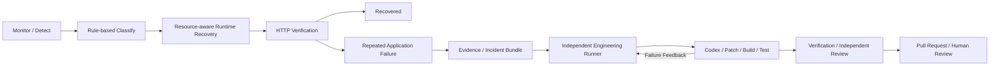

# OpsLoop

**Kubernetes 운영 복구에서 검증된 코드 수정 Pull Request까지 연결하는 Hybrid Failure-Recovery Testbed.**

OpsLoop는 Kubernetes 장애를 근거 기반 규칙으로 분류하고, 자원 상태를 고려한 Runtime Recovery를 시도하도록 설계된 프로젝트입니다. 운영 단계에서 해결되지 않는 반복 Application Failure만 독립된 Engineering Runner로 넘겨 Evidence 수집, 코드 분석·수정, Build/Test Feedback, Verification, Pull Request 생성으로 연결합니다.

> **실증 기준 (2026-10-27): Demo A 기능 E2E와 Demo B 수정 PR 제출 E2E PASS.** Demo A는 물리 AMD64 Worker의 readiness 장애에서 실제 후보 평가·Azure ARM64 재배치·새 Pod/Endpoint·Service HTTP 13회 연속 정상 응답·32.42초 안정화·Policy disabled gen8을 확인했습니다. 실제 전원 차단과 runtime-v1 전체 actor/clock 증명은 **UNPROVEN**입니다.
>
> Demo B는 빈 주문 HTTP 500이 Runtime 재배치 뒤에도 재현되어 budget 소진·Guard STOP_CONFIRMED·불변 Evidence Bundle로 연결됐습니다. 실제 `gpt-6-luna` / Medium / ChatGPT 인증 호출 1회, 수정 전 FAIL → 독립 검증 15/15 PASS, [Draft PR #6](https://github.com/SleepyMiny/OpsLoop/pull/6) 생성까지 검증했습니다. **PR_CREATED는 DEPLOYED/RECOVERED가 아닙니다.** 수정본 merge·운영 배포는 하지 않았으며 원격 CI는 확인된 receipt 기준 `NOT_RUN`입니다.
>
> **M3 통합 전시:** [설치·실행](docs/m3/deployment-runbook.md), [5~8분 시연](docs/m3/exhibition-runbook.md), [통합 아키텍처](docs/m3/architecture.md)를 사용합니다. 기본 진입점은 봉인된 Demo A/B 기록 Replay이며 Live는 별도 현재 관측입니다. M3 자체 수용 결과는 최종 `acceptance-matrix.md`와 `verification.json`으로 판정합니다. 이 README는 M3 전체 PASS를 선언하지 않습니다.

## 프로젝트의 중심

“복구 가능한 장애는 운영 단계에서 자동으로 복구하고, 운영 단계에서 해결되지 않는 코드 문제는 개발 단계까지 자동으로 연결한다.”

개발·검증 비중은 DevOps / Kubernetes / Cloud / Runtime Recovery 약 70%, AI Engineering Recovery 약 30%를 목표로 합니다. AI 코딩 자체보다 운영 복구의 책임 경계, 재현성, 검증 가능성을 우선합니다.

## 목표 흐름

모든 Runtime 실패가 Engineering으로 전환되지는 않습니다. 자원 부족, 네트워크 장애, 이미지 인증 실패, 관측 데이터 부족은 운영 대응으로 남깁니다. PR 생성은 운영 서비스 복구 완료를 뜻하지 않으며 자동 Merge·재배포는 하지 않습니다.

## 목표 Testbed

| 실행 위치 | Architecture | 역할 |
| --- | --- | --- |
| Laptop Ubuntu VM | AMD64 | 단일 k3s server/control plane, OpsLoop·관측 스택, Recovery Candidate |
| Ubuntu Physical Server | AMD64 | k3s worker, Demo API Primary, Node Failure 실험 대상 |
| Azure Linux VM | ARM64 | k3s worker, 제한된 자원의 Cloud Recovery Candidate |
| Laptop Host | Kubernetes Node 아님 | 장애 주입, HTTP 검증·시간 측정, Engineering Runner |

Tailscale 실험망과 Multi-Architecture 이미지를 사용합니다. 이 구성은 **단일 control plane을 가진 실험 환경**이며 Enterprise Production Architecture나 HA를 주장하지 않습니다.

## 실증된 대표 Demo

- **Demo A — Runtime Self-Healing:** 전용 `opsloop-demo-a/demo-api`의 readiness 장애 → Controller 자원 평가 → Azure ARM64 Worker 선택 → Deployment 변경 → Scheduler 배치 → 직접 Service 복구 → 안전 종료. 전체 물리 서버 전원 차단 시험과 구분합니다.
- **Demo B — Engineering Self-Healing:** 전용 `opsloop-demo-b/engineering-demo`의 `QUOTE_DIVISION_BY_ZERO` → 실제 Runtime 시도 소진 → Evidence → 격리 Runner의 실제 AI 수정 → 독립 검증 → Draft PR. 기존 결함 소스와 이미지는 실증 기준점으로 보존합니다.

과거 ObserveOnly 기록과 원본 Demo A/B 증거를 보존합니다. 전시 Replay나 모드 전환은 장애 주입·Enforce·배포를 수행하지 않습니다. 실환경 재실행에는 대상 UID·기한·횟수·복원 경로를 고정한 별도 승인이 필요합니다.

## 핵심 설계 결정

- Go + controller-runtime으로 Runtime Controller와 Incident Collector를 한 프로세스에 구성합니다.
- Kubernetes API는 상태·requests, Prometheus는 실제 CPU·Memory 사용량을 담당합니다.
- OpsLoop가 Node를 선택하고 `nodeSelector`를 변경하면 기본 Scheduler가 배치합니다. Custom Scheduler는 만들지 않습니다.
- `RecoveryPolicy`, `RecoveryIncident` 두 CRD에 정책과 영속 상태를 보관합니다.
- 초기 지원 대상은 replica 1개의 stateless Deployment 한 개입니다. partition 중 중복 실행을 허용하며 fencing을 보장하지 않습니다.
- Engineering Runner는 Controller와 별도 실행하며 Codex에 운영 자격 증명과 PR 게시 권한을 제공하지 않습니다.
- 로컬 검증과 GitHub Actions 실행을 구분합니다. CI workflow 게시·Git push·ACR 이미지 게시·운영 배포는 각각 별도 승인 대상입니다.

## 문서와 개발 진입점

| 문서 | 용도 |
| --- | --- |
| [M3 통합 아키텍처](docs/m3/architecture.md) | 현재 Runtime·Engineering·Live·Replay 연결과 증명 경계 |
| [M3 설치·운영](docs/m3/deployment-runbook.md) | 고정 도구, 로컬 빌드·검증, 읽기 전용 Live, 장비 이전 |
| [M3 전시 Runbook](docs/m3/exhibition-runbook.md) | 5~8분 시연, 실제 PR, 오프라인 Replay 대체 |
| [Git 통합 계획](docs/m3/git-integration-plan.md) | 미커밋 소스 보존과 main 반영 검토 구조 |
| [Architecture v0.1](docs/architecture/architecture-v0.1.md) | 기준 Architecture, 상태 머신, Contract, 보안·검증·제약 |
| [Implementation Plan](docs/implementation-plan.md) | P0~P8 순서와 Phase별 Definition of Done |
| [ADR-001: 단일 k3s control plane](docs/adr/ADR-001-k3s-single-control-plane.md) | control plane, datastore, SPOF 결정 |
| [ADR-002: Runtime Placement](docs/adr/ADR-002-runtime-recovery-placement.md) | nodeSelector, rollout, 멱등성과 partition 처리 |
| [ADR-003: Observability 기반 복구](docs/adr/ADR-003-observability-driven-recovery.md) | 데이터 권위, filter, score, freshness |
| [ADR-004: Engineering 경계](docs/adr/ADR-004-engineering-recovery-boundary.md) | Runner, Codex, 검증·게시 권한 분리 |
| [ADR-005: Hybrid / Multi-Arch Testbed](docs/adr/ADR-005-hybrid-multi-architecture-testbed.md) | Tailscale, Azure, ACR, CI/CD, Production 구분 |
| [Demo A runbook](demos/node-failure/README.md) | Node Failure 시나리오별 기대값, `run.sh` 실행 순서, 승인이 필요한 소유자 절차 |

구현 진입점은 [Controller](cmd/opsloop-controller/main.go)·[Reconciler](internal/controller/policy_controller.go), [CRD 타입](api/v1alpha1/recoverypolicy_types.go), [Demo API](apps/demo-api/main.go), [Demo Driver](cmd/demo-driver/main.go), [CI](.github/workflows/ci.yaml)입니다. 배포 manifest는 `config/`(CRD·RBAC·manager)와 `deploy/`에 있습니다. 운영 적용은 승인된 Digest·ObserveOnly Identity·내부 ClusterIP overlay로 수행했으며, 저장소 예제의 NodePort/Enforce 설정을 그대로 적용하지 않습니다.

개발 순서는 **환경 적합성 확인 → 플랫폼 → ObserveOnly → Runtime Demo A → Incident Bundle → Engineering Demo B**입니다. 과거 [P1-A Inventory](docs/experiments/p1-a-environment-inventory.md)는 당시 조사 기록으로 보존합니다. 최신 근거는 [P1-B 로컬 구축 검증](docs/experiments/p1-b-local-platform.md), [Observability 검증](docs/experiments/p2-observability-verification.md), [Azure 후보 조사](docs/experiments/p1-c-azure-arm64-candidates.md)에 있습니다.

- Arch Host: 개발·원격 관리 위치이며 Kubernetes Node가 아닙니다. 호스트 절전·Control VM 중지는 단일 Control Plane에 영향을 줍니다.
- `opsloop-control`: AMD64 단일 Control Plane, 4 vCPU / 8 GiB; Controller·관측 스택·복구 후보입니다.
- `sarmubuntuserver`: AMD64 Primary Demo API. 기존 Docker/Jenkins와 서비스·데이터를 보호합니다.
- `opsloop-azure-worker`: Azure ARM64 Worker 및 복구 후보. NodeNotReady ObserveOnly 실증 후 운영자가 start-only로 복원했습니다. 비용·토큰 만료·VM 종료는 소유자가 계속 관리합니다.

2026-10-13의 Azure Saved Plan·미구축 기록은 역사적 준비 기록입니다. 현재 배포·실증 상태는 위 요약 및 Dashboard의 증거 출처를 우선합니다.

과거 소유자 제공 기록에는 Subscription Budget **`opsloop-monthly-budget` 월 27,000 KRW**, Actual 80%·Actual 100%·Forecasted 100% 알림과 **Spending Limit On**이 명시돼 있습니다. M3에서 현재 비용·Budget 상태를 재조회하지 않았으므로 운영 전 소유자가 확인해야 합니다. 이전 Budget 미생성·KRW 금액 미확정 기록은 역사적 기록입니다. 이메일·Subscription ID는 공개 문서에 기록하지 않습니다. Budget은 알림이며 48시간 종료 타이머를 대신하지 않습니다. [최신 상태와 남은 운영 조건](docs/experiments/p1-d-azure-backend-initialization.md#11-p1-독립-감사-후-현재-상태).

[관측 values](infra/observability/kube-prometheus-stack.values.yaml)는 기존 수동 배포 파일이며 chart `91.8.1`, release `opsloop-mon`, namespace `monitoring` 기준입니다. 읽기 전용 검증은 `python3 scripts/verify-platform.py --help`, Azure 조사·배포 전 조건 확인은 `python3 scripts/azure-arm64-survey.py --help`에서 시작합니다. [플랫폼 runbook](docs/runbooks/p1-platform-preparation.md)과 [Azure 배포 준비 절차](docs/runbooks/azure-arm64-deployment.md)에 승인 경계·state·bootstrap·cleanup을 기록합니다. 관리자 kubeconfig `~/.kube/opsloop.yaml`은 출력·복사·Git 추적하지 않습니다.

## 남은 실증 및 운영 조건

- Demo A 기능 E2E 범위를 전원 차단 내성이나 runtime-v1 전체 증명으로 확대하지 않습니다. `archgram`은 실제 Control Plane VM을 호스팅하므로 전원 차단 때 원격 API PATCH·strong stop 확인이 불가능한 한계가 남습니다.
- Demo B 수정본은 PR 제출까지입니다. [선택적 ARM64 릴리스 검증 계획](docs/m3/optional-arm64-release-plan.md)의 commit·digest·대상·복원 조건을 확정하고 승인받기 전 배포하지 않습니다.
- BFF의 기존 RBAC 예제는 `opsloop-demo`용이며 Demo A/B Namespace 권한을 자동 부여하지 않습니다. 운영 설치나 scope 확대는 별도 승인 대상입니다.
- Live BFF는 Registry platform index와 직접 Service HTTP probe를 수집하지 않습니다. 결측 지표·미확인 Guard 상태를 healthy나 0으로 대체하지 않습니다.
- ACR Pull 자격 증명의 유효기간·회전, Azure 비용과 VM 종료는 소유자가 별도로 관리합니다. 과거 비용·건강 상태 기록은 현재 상태를 보장하지 않습니다.

## 기술 범위와 제외 범위

계획된 기술은 Linux, Go, Docker/Buildx, Kubernetes/k3s, controller-runtime, Helm, Azure/Terraform, ACR, GitHub Actions/OIDC, Tailscale, Prometheus/Grafana, Codex입니다. 사용 기술 목록은 현재 구현 여부를 나타내지 않습니다.

Custom Scheduler, WAN etcd HA, Service Mesh, 불필요한 메시지 브로커, 초기 AKS 이전, AI 장애 분류, Auto Merge는 범위 밖입니다. 전시 Dashboard는 기존 UI를 재사용합니다. Argo CD 도입은 현재 필수 작업이 아닙니다.

## 자격 증명과 라이선스

Terraform state·비밀 변수, credentials, kubeconfig, Runner worktree, build artifact, 로컬 환경 파일은 Git에 저장하지 않습니다. [.gitignore](.gitignore)는 실수 방지 수단이며 비밀정보 검토나 접근 통제를 대신하지 않습니다. `.terraform.lock.hcl`과 비밀값 없는 명시적 예제 파일은 향후 추적 대상입니다.

라이선스는 아직 선택하지 않았습니다. 사용자 선택 없이 `LICENSE`를 생성하지 않았으며, 공개·배포 조건을 정할 때 별도로 결정합니다.
