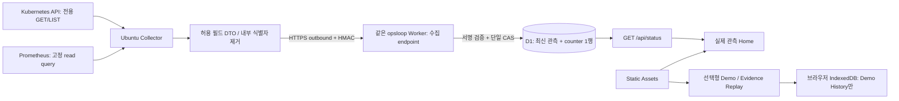

# 구조와 최소 변경 결정

## 확인한 소스와 재사용 경계

| 소스 (기준 main) | 확인한 동작 | 재사용 / 변경 |
|---|---|---|
| internal/dashboardbff/bff.go:50–119, GetOnly/NewKubernetesReader/Read | 클라이언트 GET만 허용. 현재 Nodes 및 전체 namespace Pods LIST, 단일 Policy/Deployment GET, Incident LIST | transport·typed client 생성 재사용. 공개 Collector에는 더 좁은 별도 reader 필요 |
| internal/dashboardbff/bff.go:122–154,296,325,360 | metadata UID/name, 노드 hostname, workload selector/digest 및 정책 spec/status를 반환 | **Assemble 결과를 공개 전송하지 않음**. 원본 객체→새 공개 DTO 직접 구성 |
| internal/dashboardbff/bff.go:172–200, metrics | 내부 IP로 원본 timestamp를 연결하되 7개 값 중 누락 하나면 usage 전체 null | 연결·숫자 검사 아이디어 재사용. 공개 DTO는 CPU/Memory/exporter별 독립 유효성·freshness 검사 |
| internal/candidates/prometheus.go:44–93, QueryMetrics | 7개 고정 instant query, 원본 sample/labels, instance→host 매핑 | 고정 query/중복 시계열 검출 재사용. labels/IP/상세 오류는 로컬에서 폐기 |
| internal/dashboardbff/prometheus.go:14–48 | Prometheus query endpoint만 허용, form POST를 GET로 변환 | 재사용. URL은 고정 서버 설정, 브라우저 입력 사용 금지 |
| cmd/dashboard-bff/main.go:20–75 | loopback BFF, 서버 측 credentials, 읽기 전용 수집 | 로컬 Live 유지. 공개 reverse proxy나 원격 관리자 kubeconfig 복사는 하지 않음 |
| frontend/dashboard/src/data/live/httpSource.ts:52–123 | poll/cancel/generation guard, 오류 시 last-good 표시, Demo 대체 없음 | poll 생명주기 패턴 재사용. 기존 parser는 내부 snapshot 전용이므로 새 PublicStatus 타입/parser 분리 |
| src/public/createPublicDataSource.ts:13–26 | 현재 기본 Demo, autoPlay/autoLoop 기본 true, Live 명시 차단 | 새 Home 라우터 추가. Home에서 DemoDataSource 생성/시작 금지, 선택 시만 시뮬레이션 |
| src/data/demo/demoSource.ts:11,64–66,143,215,238–242 | 메모리 history 6개, select 시 archive. 종료·새로고침 영속 이력 아님 | 기존 엔진 재사용 + Session/History wrapper 추가. 끝/중지/재진입 저장을 별도 구현 |
| src/data/replay/replayCore.ts, src/public/evidence.public.json | 정제된 두 실제 실험의 고정 frame 재생 | 수정 없이 유지. Home/Demo History와 섞지 않음 |
| frontend/dashboard/wrangler.public.json | name=opsloop, 순수 assets만. Worker/D1/credentials 없음 | 기존 pure-static 설정 유지. 다음 구현에서 별도 status profile을 검증 후 전환 |
| public-static/_headers, scripts/audit-public.mjs | 현재 connect-src none, API 모듈 제외·정적 설정 exact-key 검사 | 기존 검사를 약화하지 않음. 새 profile은 exact same-origin API allowlist·별도 CSP/audit 필요 |

위 경로의 frontend 축약은 `frontend/dashboard/` 기준이다. 현재 소스에 outbound Collector,
수집 인증 endpoint, D1 저장소, Public Status Home 또는 영속 Demo History는 없다.
이전 서버 인벤토리에서 K8s TCP/Prometheus ready 접근은 확인했지만
전용 Identity의 서버 측 인증 GET·새 Collector 실행은 미검증이다.

정확히 구분하면 Node InternalIP는 기존 BFF의 metrics join에 쓰이고 현재 Node 응답에
직접 직렬화되지는 않는다. 확인된 공개 부적합 항목은 노드명/UID/hostname/자유 형식 taint와
정책 상세 등이다. 별도 DTO는 이들뿐 아니라 향후 내부 IP가 추가되는 경로도 차단한다.

## 데이터 흐름

Worker/D1는 Kubernetes/Prometheus에 접근할 credentials나 private 네트워크 경로가 없다.
브라우저 요청 때문에 Collector가 API를 추가 조회하지 않는다. 수집 주기는 독립적이다.
관리 포트·kubeconfig·SSH 키를 노출하는 Tunnel/인바운드 포트가 필요하지 않다.

## D1 필요성과 비용

| 안 | 장단점 | 결정 |
|---|---|---|
| Worker 메모리 | isolate 재시작/지역별 상태, 재송신 방지·영속성 불가 | 제외 |
| 정적 파일 주기 재배포 | 빌드/배포가 상태 갱신에 결합, 짧은 주기 부적합 | 제외 |
| KV | 최신 상태 캐시에는 가능하나 eventual consistency만으로 글로벌 CAS replay fence 보장 불가 | 이번 안 제외 |
| D1 단일 행 | 시퀀스·최신 공개 body를 단일 조건 UPDATE, 재시작 후 유지, 관측 UI에 충분 | **채택** |
| 별도 Durable Object/Queues/시계열 DB | 더 강한 조율·대량 이력이 필요할 때 검토 | 이번 범위에 추가하지 않음 |

초기 Collector 30초, 브라우저 Home 30초 polling. tick overlap 금지, 한 번에 한 POST.
소스별 deadline과 전체 12초 제한; component 실패도 같은 주기로 null/error heartbeat 전송.
전송 실패는 jitter/backoff(30→60→120→300초), 오래된 큐를 보내지 않고 최신 관측만 재수집.
숨겨진 탭 및 Demo/Replay 화면은 Home poll 중지. 탭 복귀 시 즉시 갱신.

- 30초 수집: 2,880회/일. D1는 상수 크기 1행 UPDATE. source JSON 최대16KiB.
  허용 빈도 최대 15초/쓰기이며 인덱스 비용을 포함해 실제 rows_written 계측 필요.
- Home 동시 N명, 24시간 polling 가정: Worker 동적 요청 약 `2,880 × (N+1)`/일.
  25명이면74,880회, 50명이면146,880회로 Free 100,000/day를 초과할 수 있다.
  무료 계정 전체 공유량·다른 Worker 사용량 및 retry도 고려해야 한다.
- D1 Free 기준 읽기500만/일, 쓰기10만/일, 총5GB. 최신 행만 보관하여 저장량은 작다.
  추정치이지 비용0원/무제한 가용성 보장은 아니다. 실제 계정 plan/잔여 quota는 미검증.
- 정적 asset 요청은 Worker를 거치지 않도록 유지한다. free quota 소진 시 Home은 unavailable,
  Demo/Replay는 asset 경로로 남겨야 한다. 실제 Edge에서 이 분리는 배포 수용 조건이다.

쿼리는 PK 1행만 읽으며 기록형 time-series, 방문객 IP 저장, raw logs 보관은 추가하지 않는다.
계정 사용량 초과를 이유로 유료 전환하지 않는다. 트래픽이 커지면 polling을60초 이상으로
늘리는 승인안부터 검토한다. 캐시를 추가해도 Worker invocation quota 자체가 없어지지는 않는다.

## 화면과 History 결정

- 기본 `/`: 현재 관측 Home. 수신 시각/원본 측정 시각/지연과 부분 실패를 보여준다.
  결과가 없으면 '관측 데이터 없음', 자동 Demo 대체 금지. '실시간'은30초 주기 관측임을 표시한다.
- `?source=demo`: 사용자가 시나리오를 선택해 시작할 때만 엔진 생성/시작.
  autoLoop=false. 종료 또는 사용자 중지 시 한 번 저장하고 Home 복귀 가능.
  종료/중지/seek-to-end를 구분해 완료 여부를 과장하지 않는다.
- Demo History: IndexedDB, 최대50회/30일, 저장 실패 안내와 삭제 기능.
  session UUID, scenario/engine version/seed, 실제 시작·끝, simulated elapsed,
  completed/stopped/interrupted, seek 사용 여부, 허용된 결과 summary만 저장한다.
  출처는 항상 simulation. 현재 Incident나 실제 실증으로 합산하지 않는다.
  브라우저별 이력이며 기기 간 공유되지 않는다. 전역 공유는 인증/남용 방지 별도 설계·승인 대상이다.
- `?source=replay`: 기존 IMAGE_PULL/NODE_NOT_READY 정제 증거와 ObserveOnly/운영자 복원 표시 유지.
- 비공개 `source=live` BFF 흐름은 그대로 둔다. 공개 Home은 축약 observed 계약이며
  기존 Live의 raw DashboardSnapshot과 다르다. 미지원 mode는 오류 안내, 대체 없음.

새 `PublicStatusHome`을 기존 `App`의 Demo/Replay UI와 나란히 둔다.
UID/Policy 상세가 필수인 `DashboardSnapshot`에 가짜 UID·빈 Decision을 채워 맞추지 않는다.
시각 카드가 재사용 가능하면 표시용 props만 추출하며 기존 도메인/Controller를 바꾸지 않는다.
