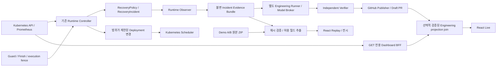

# M3 통합 아키텍처

대상은 기존 Hybrid Kubernetes를 운영하는 개발자와 전시 운영자입니다. 기존 Controller·CRD·Guard·Observer·Engineering Runner를 유지하고 관측·증거 adapter와 React 진입점을 통합합니다. 이 문서는 현재 소스의 구조를 설명하며, 새 클러스터 배포 완료나 M3 전체 PASS를 뜻하지 않습니다.

## 구성요소와 책임

| 구성요소 | 구현 | 책임과 경계 |
| --- | --- | --- |
| Runtime | `internal/controller/`, `internal/candidates/`, `api/v1alpha1/` | 실제 조건·자원·Policy를 평가하고 허용된 실행 범위에서 조치합니다. M3 관측 통합 때문에 엔진을 재작성하지 않습니다. |
| Guard / Finish / Observer | `cmd/demo-driver/` | 실행 기한·횟수·grant·fence, 종료 및 관측 증거를 담당합니다. Dashboard는 실행 grant를 만들지 않습니다. |
| Evidence | `tools/engineering_evidence/` | Incident·실패 재현·원본 해시·소스 provenance를 묶습니다. |
| Engineering | `tools/engineering_runner/` | 모델 호출과 격리 Runner를 담당합니다. AI에 Kubernetes 변경 권한을 주지 않습니다. |
| 독립 검증·게시 | `tests/engineering/`, `tools/engineering_publisher.py` | 별도 고정 소스 검사·테스트·검토 후 PR을 생성합니다. PR 생성은 배포가 아닙니다. |
| Live 관측 | `internal/dashboardbff/`, `cmd/dashboard-bff/` | 고정 Namespace/Policy에서 GET으로 관측하고 비밀이 없는 필드만 제공합니다. |
| Engineering 연결 | `tools/engineering_dashboard_bridge.py`, `src/data/live/engineeringJoin.ts` | 원본 해시와 Incident·workload·Policy·run/epoch 연결이 맞을 때만 상태를 결합합니다. |
| 봉인 기록 재생 | `tools/m3_evidence.py`, `frontend/dashboard/src/data/m3/evidence.json` | 고정 ZIP 해시와 manifest를 검사하고 검토된 요약·원본 파일을 제공합니다. |
| 전시 화면 | `frontend/dashboard/src/m3/` | Live와 과거 기록의 의미를 구분하고 기존 Live UI·데이터 adapter를 재사용합니다. |

## 식별자와 관측 시간

Deployment 이름만으로 Runtime과 Engineering을 결합하지 않습니다. 동일 이름이라도 Namespace·Deployment UID·Policy UID·Incident UID가 다르면 별개 실행입니다. run ID와 epoch는 Runtime 실행을 구분하며 Engineering job ID와 별도 필드입니다.

Replay 계약 `opsloop-m3-evidence/v1`은 실행별 `binding`에 Incident UID, run ID, epoch, Namespace, Policy UID, Deployment UID, Pod UID 목록을 보관합니다. 주요 이벤트에는 원본 archive, 경로, SHA-256과 원본 시각이 연결됩니다. 개인정보 최소화 다운로드는 원본 hash와 다운로드 hash·변환 설명을 별도로 표시합니다. 원본에 없는 값은 `null` 또는 미확인으로 남기며 화면 재생 간격을 실제 사건의 소요 시간으로 해석하지 않습니다.

Live의 `observedAt`은 BFF 현재 관측 시각입니다. 과거 Engineering receipt 시각을 최신 Live 시각으로 덮어쓰지 않습니다. BFF의 `runtimeBinding`은 현재 Policy grant와 Incident binding이 일치하는 경우에만 파생합니다. grant가 교체·삭제되어 연결을 증명할 수 없으면 과거 PR을 현재 실행에 붙이지 않고 Replay에서 확인합니다. 새로운 cluster/Namespace UID 조회 권한을 요구하지 않습니다. `m3-serve.py --engineering-artifacts PATH`를 명시하면 시작 시 기존 Engineering bridge의 projection 검증으로 artifact manifest·bundle·수정 결과·독립 검토·PR receipt 해시를 대조합니다. 이후 매 GET에서 현재 BFF snapshot과 UID/run/epoch/grant binding이 정확히 일치할 때만 과거 Engineering 증거를 연결합니다. 현재 Pod의 role·배치·readiness를 과거 자료로 덮어쓰지 않습니다. 옵션이 없으면 Live는 BFF 현재 관측만 제공하며 실제 Demo B AI·검증·PR 상세는 봉인 Replay에서 확인합니다.

## Live와 Replay의 데이터 권위

| 데이터 | 권위 | 결측·연결 실패 처리 |
| --- | --- | --- |
| Node Ready, Pod UID·phase·readiness, requests | Kubernetes GET | 실패를 disconnected로 표시하고 오래된 snapshot은 현재 정상으로 선언하지 않습니다. |
| CPU·메모리 사용량 | Prometheus 원본 sample timestamp | 누락·중복·비정상 표본은 null, 0%로 바꾸지 않습니다. |
| 현재 Incident | Policy가 참조하고 UID가 맞는 active Incident | 최근 FAILED 이력만으로 현재 장애를 선언하지 않습니다. |
| 현재 Policy | 현재 spec/generation/observedGeneration | disabled가 과거 Guard receipt의 현재 유효성을 자동 증명하지 않습니다. |
| 직접 Service HTTP·복구 시간 | Demo 원본 Observer/검증 기록 | BFF 미수집 항목은 미확인으로 둡니다. Pod Ready와 HTTP 200을 동일하게 보지 않습니다. |
| 후보 선택·재배치·PR·독립 테스트 | 봉인 원본과 해시 연결 | 과거 결과로 표시하며 현재 cluster 상태로 사용하지 않습니다. |

기본 전시 진입점은 검증된 기록입니다. Live를 선택하면 BFF 현재 관측을 사용하며 실패 시 자동으로 성공 Replay로 바꾸지 않습니다. 사용자가 Replay로 명시 전환할 수 있습니다. 모드 선택은 Enforce, 장애 주입, 모델 호출, Git 변경을 수행하지 않습니다.

## 증거 범위

Demo A의 기능 E2E PASS는 readiness 장애·실제 후보 선택·ARM64 Pod 전환·Endpoint·직접 HTTP 13회 연속 정상·32.42초 안정화·Policy disabled gen8 범위입니다. 실제 전원 차단 및 runtime-v1 전체 actor/clock 증명은 UNPROVEN입니다. Observer 원본 manifest는 ZIP에 모든 파일이 포함된 형태가 아닙니다. ZIP 포함 파일 해시 일치와 미포함 범위를 함께 기록합니다. 별도로 기존 로컬 Observer 원본 2,407개 파일을 동일 manifest에 대조했으나 `complete-with-gaps`·`liveProof:false`는 그대로이며 전체 actor/clock 증명으로 확대하지 않습니다.

Demo B의 PASS는 실제 HTTP 500 반복·Runtime 시도 소진·Guard STOP_CONFIRMED·봉인 bundle·실제 Luna 수정·독립 검증 15/15·Draft PR #6 제출 범위입니다. PR 수정본의 운영 배포·현재 서비스 복구·native ARM64 실행은 별도 미실증 범위입니다. ARM64 교차 빌드는 native 실행 증명이 아닙니다.

`archgram`은 실제 Control Plane VM을 호스팅합니다. 호스트 전원 차단 시 Kubernetes API PATCH와 원격 strong stop 확인이 불가능한 기존 제약을 해결했다고 주장하지 않습니다. M3는 전원 차단 실험을 수행하지 않습니다.
